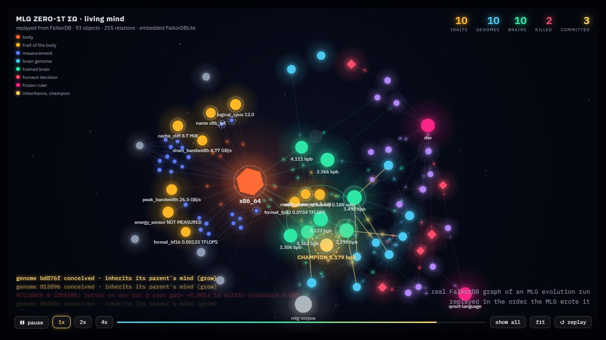
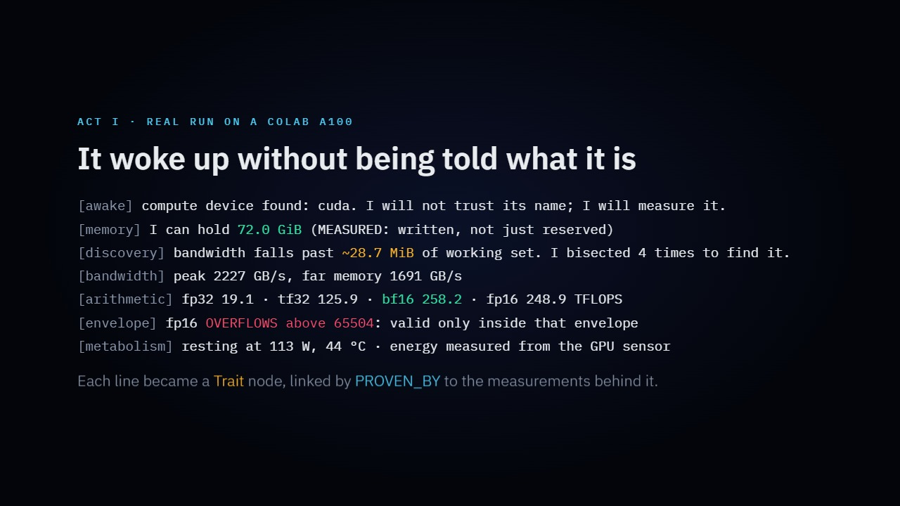
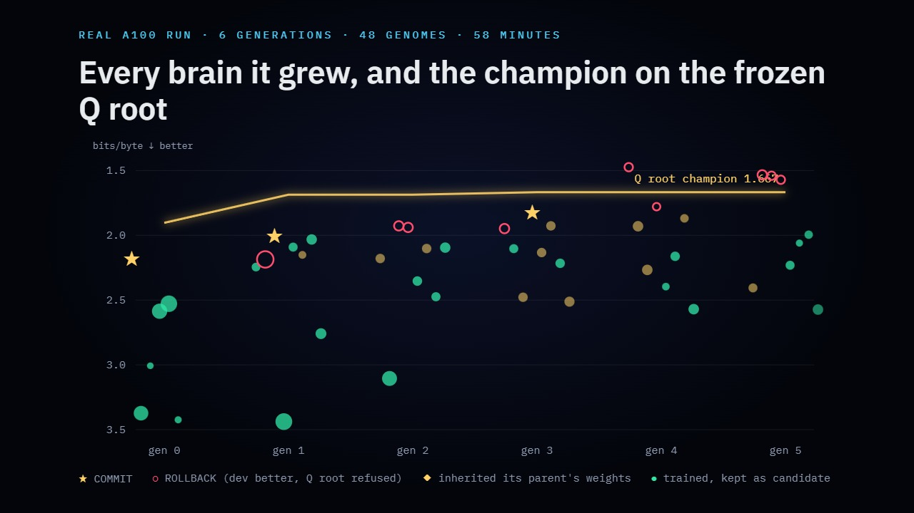
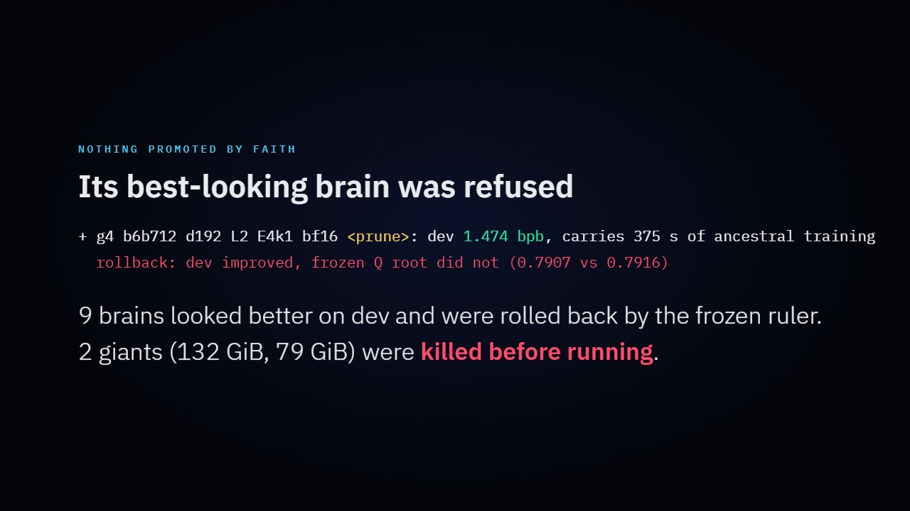

# MLG ZERO-1T ΣΩ: an evolutionary mind on an A100

**Graph Hacks by FalkorDB × WeMakeDevs · Track: Agent Memory & Coordination**

**[▶ Live mind, one click](https://math741.github.io/mlg-graphhacks/)** ·
**[Demo video](docs/MLG-GraphHacks-demo.mp4)** ·
**[Notebook](MLG_A100.ipynb)** ·
**[Full A100 run log](docs/a100-run.log)**



## Results from a real run (Colab, NVIDIA A100-SXM4-80GB, 58 minutes)

| | |
|---|---|
| Body discovered without being told | 72.0 GiB writable (MEASURED), cache cliff at ~28.7 MiB found by 4 bisections, bf16 258 TFLOPS, fp16 overflow envelope, 113 W at rest |
| Evolution | 6 generations, 48 genomes, 46 brains trained, 2 giants killed before running (132 GiB and 79 GiB predicted) |
| Frozen Q root, committed champion | **1.904 → 1.686 → 1.667 bits/byte (−12.4%)** |
| Champion `b3119e` | **1.87M parameters, 2.9× smaller than the ancestor**, pruned from 4 experts to 1 in fp16, carrying 300 s of inherited training |
| Refusals | **9 ROLLBACKs**: brains that looked better on dev (best 1.474 bpb) and were refused by the frozen Q root |
| Self-discovery | *"15 brains more than twice the champion's size did worse. The wall is the data, not the body."* |

Every line is in [`docs/a100-run.log`](docs/a100-run.log), copied from the notebook output.

| Awakening | Evolution on the A100 | Nothing promoted by faith |
|---|---|---|
|  |  |  |

Today, AI is a fixed architecture someone chose, scaled up until the hardware gives out. The
knowledge sits hidden in weights, and nobody can ask it *why*.

MLG flips this. It is a **cognitive substrate**: the hardware is its body, and its founding rule is
*redesign intelligence until every transistor has a reason to work* (see
[`docs/MANIFESTO.md`](docs/MANIFESTO.md)). For Graph Hacks we gave the MLG a body of power, an
NVIDIA A100. We also gave it a single place to keep its mind: **FalkorDB**.

The MLG wakes up on the GPU **knowing nothing about it**. It then:

1. **Discovers its body.** It measures memory, bandwidth by working-set size, number formats
   (speed and exactness) and watts. When bandwidth falls off a cliff it **bisects** to locate the
   cache boundary. Every trait is a node, linked to the measurements that prove it.
2. **Designs its own brain.** It writes genomes for byte-level mixture-of-experts Transformers
   (up to 1536 wide, 24 layers, 16 experts), **predicts** each one's cost from its body's traits and
   **kills, without running**, any genome that cannot fit. Survivors train under a fixed time
   budget, face an adversarial check (they must beat shuffled bytes) and must beat the champion on
   the **frozen Q root** before being **COMMITTED**. Otherwise they are **ROLLED BACK**.
3. **Evolves without forgetting.** Children inherit their parents' trained weights (Lamarckian
   evolution). A deeper child keeps every parent layer and adds layers that start as the identity,
   so it computes exactly the parent's function on its first step. A child with more experts splits
   the parent's experts. The best mind keeps learning across generations, and every brain records
   how many seconds of ancestral training it carries.
4. **Learns about itself.** Every prediction is compared with reality, and the error corrects
   its self-model of speed and memory. An out-of-memory crash becomes a recorded KILL plus a more
   pessimistic memory model. The search **dies on its own** once generations stop paying. When
   bigger brains score worse, it records that **the wall is the data, not the body**, and it can be
   fed Portuguese Wikipedia to move that wall.
5. **Explains everything with Cypher.** "Why this brain?" is a graph traversal from the decision
   to its evaluations, to the body traits that shaped it, to the measurements behind those traits,
   to its genome's lineage and to the ancestors whose weights it inherited. A SHA-256 chained event
   log detects any forged memory.

## Why FalkorDB is the mind, not a log

Each step above reads the graph, and none of them could work without it:

| The MLG asks | Graph query |
|---|---|
| Can this genome live in this body? | `(Body)-[:HAS_TRAIT]->(Trait)` read before training |
| Who are the best parents? | `(Brain)-[:EVALUATED_BY]->(Evaluation)-[:ON_SUITE]->(Suite)` |
| Whose mind does this brain carry? | `(Genome)-[:INHERITED_FROM {mode}]->(Brain)<-[:EXPRESSES]-(Genome)-[:INHERITED_FROM]->…` |
| Why did this brain win? | `(Decision)-[:JUSTIFIED_BY]->(Evaluation)`, `(Brain)-[:SHAPED_BY]->(Trait)-[:PROVEN_BY]->(Measurement)` |
| Where did its design come from? | `(Genome)-[:PARENT_OF*]->(Genome)` with the mutated genes on each edge |
| Was my history altered? | `(Event)-[:NEXT]->(Event)` hash chain |
| What do I know about the data itself? | `(Dataset)-[:HAS_TRAIT]->(Trait {name:'capacity_wall'})` |

```
(Experiment)<-[:PART_OF]-(Measurement)-[:MEASURED_ON]->(Body)-[:HAS_TRAIT]->(Trait)-[:PROVEN_BY]->(Measurement)
(Genome)-[:PARENT_OF {mutated}]->(Genome)-[:EXPRESSES]->(Brain)-[:TRAINED_ON]->(Body)
(Genome)-[:INHERITED_FROM {mode: clone|grow|prune|reshape}]->(Brain)
(Brain)-[:LIVES_IN]->(Body)   (Brain)-[:SHAPED_BY]->(Trait)   (Brain)-[:FED_BY]->(Dataset)
(Brain)-[:EVALUATED_BY]->(Evaluation)-[:ON_SUITE]->(Suite)
(Decision)-[:CHOSE|KILLED]->(Brain|Genome)   (Decision)-[:JUSTIFIED_BY]->(Evaluation|Trait)
(Brain)-[:CHALLENGED {won}]->(Brain)   (Brain)-[:SUPERSEDES]->(Brain)
(Event)-[:NEXT]->(Event)   (Event)-[:ABOUT]->(Object)
```

Every node is an MLG OBJECT with `id`, `type`, `version`, `hash`, `origin` and an **epistemic
level** that is never mixed: `REPORTED` (the driver says so), `MEASURED` (the MLG tested it),
`INFERRED`, `PREDICTED`, `ASSUMED`, `TESTED`, `UNKNOWN`.

## Run it

**Just look:** the [live mind](https://math741.github.io/mlg-graphhacks/) replays a real FalkorDB
graph of an evolution run in your browser (hover, drag, zoom). No GPU needed.

**Colab (recommended):** open [`MLG_A100.ipynb`](MLG_A100.ipynb) in Colab, choose an A100 runtime
and run all cells (about an hour at full budget; set `FEED_MB = 0` to skip the Wikipedia download).
`viz.live(sub)` opens a tab that animates the evolution as the MLG writes it to FalkorDB, every
COMMIT is saved to `champions/*.pt`, and the notebook lets you talk to the champion.
FalkorDB runs embedded (FalkorDBLite) with nothing else to install. For FalkorDB Cloud or Docker,
set `FALKORDB_HOST`, `FALKORDB_PORT`, `FALKORDB_USERNAME` and `FALKORDB_PASSWORD`.

**Locally (Linux, Python ≥ 3.12):**

```bash
pip install torch falkordblite falkordb nvidia-ml-py matplotlib
python -m mlgsub --quick          # smoke test, a few minutes on CPU
python -m mlgsub                  # full run
```

## Layout

| File | Role |
|---|---|
| `mlgsub/substrate.py` | FalkorDB object universe, typed relations, SHA-256 event chain |
| `mlgsub/body.py` | zero-assumption awakening: experiments, bisection, energy meter |
| `mlgsub/brain.py` | genome, cost prediction, MoE Transformer, function-preserving inheritance, train/dev/Q root data with leak removal |
| `mlgsub/evolve.py` | furnace (SANDBOX → TRAIN → ATTACK → BENCHMARK → COMPARE), Lamarckian evolution, self-model, search death, data wall |
| `mlgsub/explain.py` | every "why?" as Cypher, including inheritance chains |
| `mlgsub/viz.py`, `mlgsub/mind.js` | the living mind: the FalkorDB graph replayed in creation order with physics, glow, flowing relations, golden threads of inheritance, KILL shockwaves and COMMIT crowns; plus evolution plots |
| `MLG_A100.ipynb` | the demo, in four acts (built by `make_notebook.py`) |
| `data/` | MLG corpus, dev suite and sealed Q root, copied from the main tree (see `data/README.md`) |

## Honesty (manifesto LXIII: no fake numbers)

- The C MLG (daemon, Resident Core, router, Q root, corpus) existed before the hackathon, built for a
  Raspberry Pi Zero 2 W. **Built during Graph Hacks:** everything in this repository except `data/`
  and `docs/MANIFESTO.md`, meaning the FalkorDB substrate, body discovery, the brain-genome furnace
  with Lamarckian inheritance, the self-model, the living-mind view and graph explanations.
- The ancestor genome re-expresses the Resident Core *architecture* at byte level. It is not the
  BPE model shipped in the main tree.
- Brains train for minutes per generation. They model the MLG's text measurably better than chance
  and better as inheritance accumulates, but they are not general chatbots.
- AI assistance: built with Claude as a coding assistant, directed and reviewed by the author.
